Why even use minimalist keyboards?

Are those actually ergonomic?

Why 34 keys?

How do you even type on this?

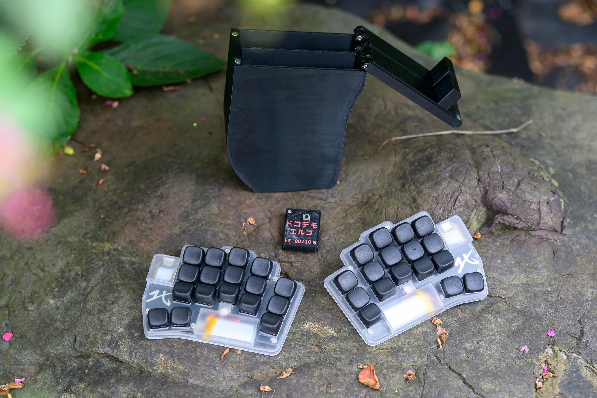

Those are the kinds of questions I get every time someone sees my weird-ass keyboards.

I'm at a point where I'm pretty confident 34 keys is the right number. Let me explain why.

# The base case

## Finger travel bad

The first obvious gain of compact keyboards is reduced finger travel.

The fewer the keys, the less movement. This both reduces fatigue and increases speed.

Stenographers actually use only 23 keys:

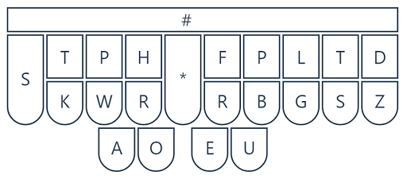

While there's no good, peer-reviewed research on this exact subject, I do feel like it's more
comfortable not to have my hands fly all over the keyboard when typing. I can stay relaxed and keep
my shoulders and arms in a neutral position while I type, even for long stretches of time.

## Thumb strong

The second core feature of compact keyboards is the thumb cluster. While we're making the keyboard
much smaller, we're actually making greater use of the thumbs.

With two keys per thumb, we can properly use all 10 fingers to type and therefore reduce the strain
on each finger a bit more.

Two thumb keys are a good middle ground: you get one at the resting position of your thumb and a
second one easily accessible with little exertion.

No weird extension, no stacked keys.

I'll delve a bit deeper into 2 vs. 3 thumb keys below.

## Look keyboard bad

One weird hidden quality of extremely small keyboards is that they force you to _never_ look at
them.

Once you cram the features of a standard 105-key keyboard into 34, you end up using layers. Your
keys play triple duty.

And there's no keycap that shows all that. You'll _need_ to create a solid mental mapping between
your fingers and what's happening on the PC.

No looking down. Ever.

At the same time this is made considerably simpler by the fact that compact layouts have a strong
internal logic to them. By now we've arrived at pretty refined solutions, my favorite being
[Selenium](https://onedeadkey.github.io/selenium/).

Numbers are arranged in the shape of a numpad. Arrows are in the shape of a standard arrow cluster.
Parentheses are symmetrical in the symbol layer.

This is a far cry from the arbitrary nature of the QWERTY symbols and non-alphanumeric keys.

So while full touch typing is possible on a normal keyboard, it's imo much more convenient on
compact ones. And that includes all symbols, numbers, and modifiers.

# Ergo?

Having an extremely small, split, wireless keyboard means I can position it freely, tenting it at 45
degrees or even mounting it directly to my chair.

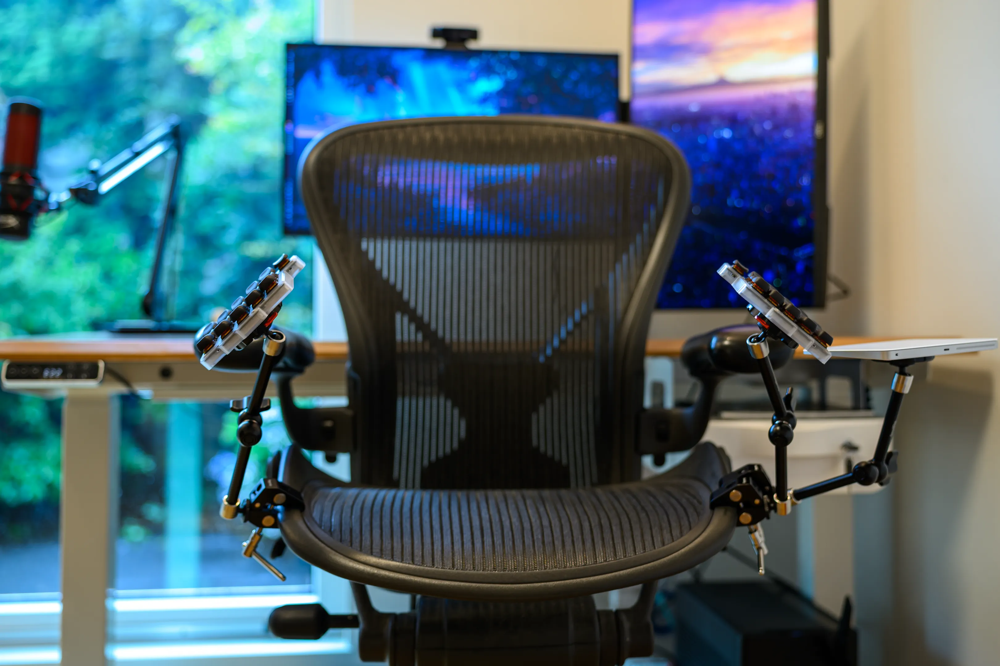

To me, this is peak ergo.

Ergonomics also means being able to move and adjust your setup during the day. You don't want to be
in the exact same position for hours on end.

Being small, split, and wireless makes this movement possible. You can easily move from chair to
table, from table to MagSafe mounts, ...

I really can't go back to bigger boards. My wrists just start hurting after a few hours of intense
typing.

So I'd say yes. These keyboards are extremely ergonomic. You see very few people moving back to
bigger boards after getting used to ergo keyboards.

Please note that this also requires using a proper ergonomic keyboard layout. No amount of key
position changes will make QWERTY decent for typing.

I wrote a bit about it here:



---

# The nerd addendum

By now, I hope I've convinced you that small, split, wireless keyboards are good.

But how many keys _exactly_ should you run?

## 34? Damn casual, I run 30

So I _did_ run 30 keys for about a year:

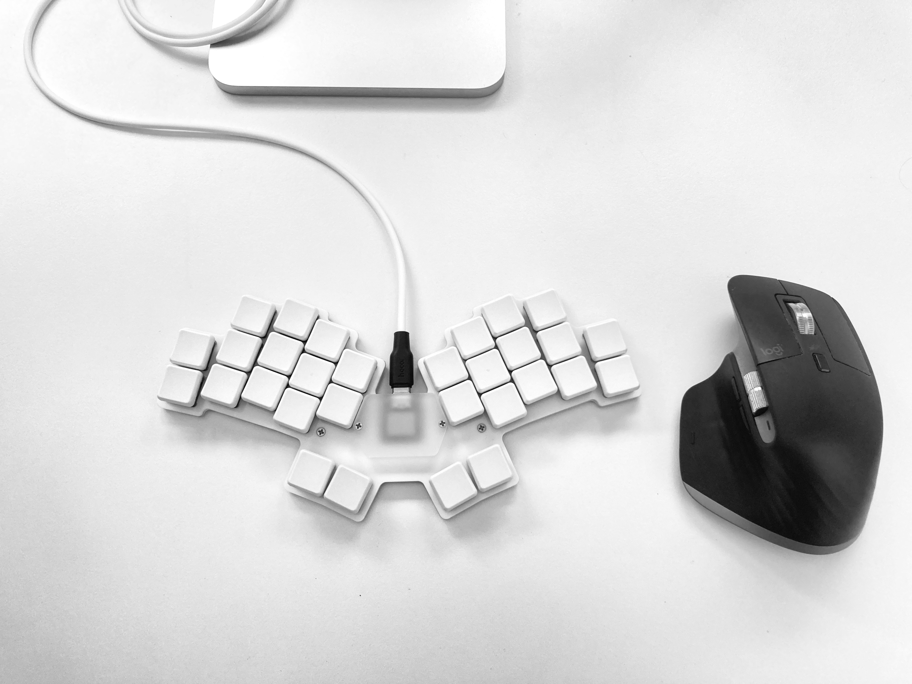

And honestly? It wasn't that bad.

30 is extreme, for sure, but also manageable.

At the same time, needing combos for some letters just felt a bit weird. While I _could_ make it
work, I felt like I was not gaining much from it compared to adding a few more keys.

## 34? I really need 36

So the first keyboard I designed myself after running 30 keys for a year had 36 keys:



Moving back up to 36 after 30 gave me so much more space to play with in my keymap.

So much that I ended up not knowing what to do with the extra keys.

While the 36-key layout worked extremely well, I ended up not really using the outer thumb key that
much. I already had all the keys I needed in better positions, comfortably accessible.

So about a year later I tried the Sweep and finally settled on 34 keys:

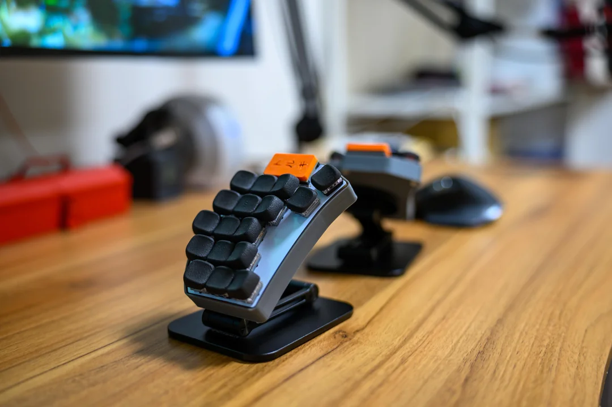

## 34? I only use 40

Generally, ~40-key ergo split keyboards seem to be a bit more "mainstream".

That's the size of the [Corne](https://github.com/foostan/crkbd), one of the OG split ergo
keyboards.

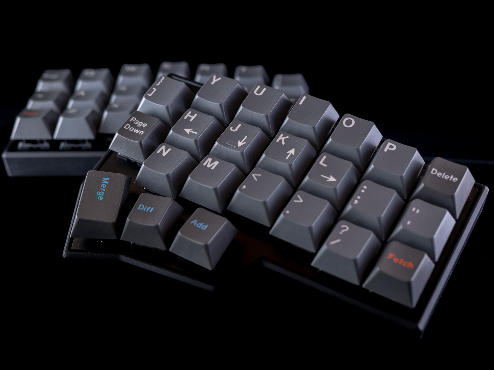

Some modern ergo split keyboards like the
[Keychron Orca echo](https://www.gizmodo.jp/article/keychron-orca-echo-on-computex-2026/) even go up
to 49.

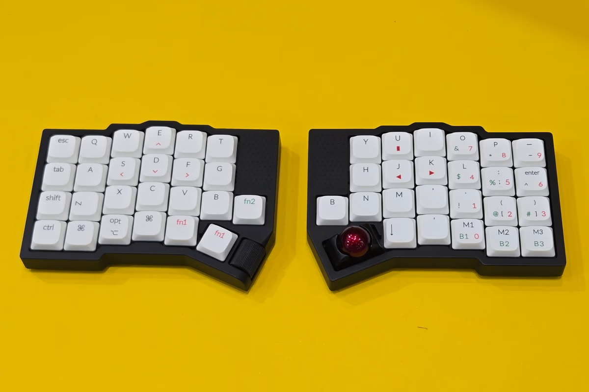

Not to mention the [Voyager](https://www.zsa.io/voyager), which is the keyboard I see many
influencers in the field settling on:

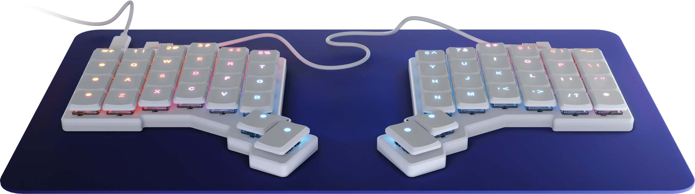

And you know, having more keys is not _bad_ per se.

It's just that at some point, they don't add much.

I don't want my numbers spread over two hands, requiring me to move my whole hand to type them.

I don't want Tab on a double pinky extension.

I don't want to have to move my whole hand to hold multiple modifiers at once.

I don't even want to entertain the idea of having a key that requires my pinky to move **three** key
spaces to press it!

## Where pinky

Talking about the pinky, where to put its third key?

Flexing the pinky feels natural, so we should have one key in the resting position + one key beneath
it. But the third key is actually more ergonomic on the _side_ of the pinky rather than above.

I won't argue with this. That's why it was on the side for the Tolkeeb Alpha:

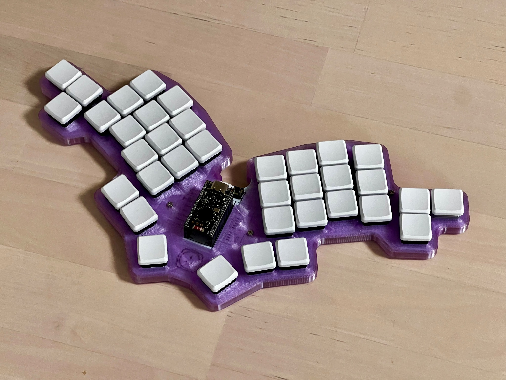

It's also the position chosen by a few popular boards like the
[TOTEM](https://github.com/GEIGEIGEIST/TOTEM):

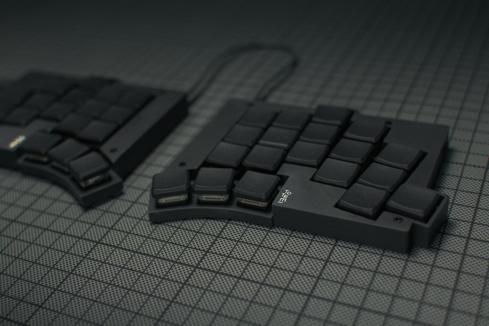

My issue with this is that it adds ~2 cm of width to the keyboard, which means you _will_ have to
tent it higher on a table. And I feel like tenting on top of the table is the standard use case of
these keyboards. And tenting it higher is generally bad. That's the whole point of low-profile
keyboards tbh.

So while I prefer pinky side movement to the top extension, I feel like it's worth moving the third
pinky key _above_ so the keyboard can sit a few centimeters lower when tented.

And this is supposed to be the least-used key on the keyboard anyway!

## 34 it is

So it's simple:

- 30 requires combos for some letters. It's clunky.
- 36 adds two thumb keys, but they went unused with my layouts.
- 40+ keys require too much hand movement with no real gain.

# How?

Here's the default keymap for the DDE:

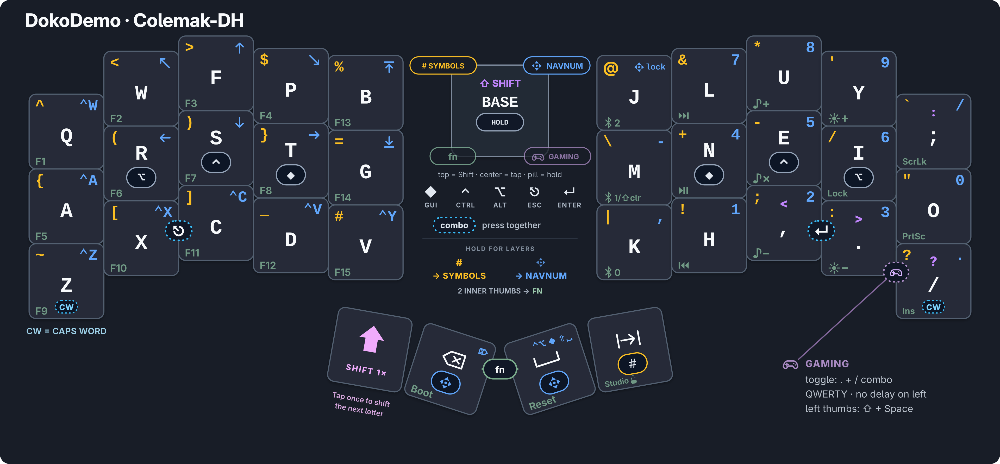

I will make a separate article on the subject, but the gist of it is:

- [Layers](https://zmk.dev/docs/keymaps/behaviors/layers) let you access every keycode available on
  a normal keyboard.
- [Home Row Modifiers](https://precondition.github.io/home-row-mods) let you chord modifiers like
  Super, Ctrl, or Alt without leaving the home row.
- [Combos](https://zmk.dev/docs/keymaps/combos) make keys like Enter or Escape accessible without
  requiring a dedicated key.

It's really not that hard, and you can get used to it in a few days.

# The end

I hope this made you curious and willing to try out 34-key layouts.

34 is love. 34 is life.

34 is justice.
